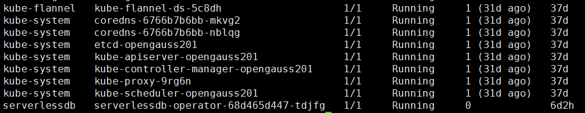

# openGauss Branching on Kubernetes

本目录提供一套基于 Kubernetes YAML 模板的 openGauss branching 部署方式，以及用于管理 Safekeeper、Pageserver、计算分支和分支合并的本地运维命令。部署方案结合 `serverlessdb-operator` 的计算资源池能力，将分支数据库的计算实例纳入池化管理，以支持计算资源的按需分配、弹性扩缩和生命周期管理。

serverlessdb-operator 具体介绍见 [`serverlessdb_operator.md`](https://gitcode.com/openFuyao/sig-orchestration-engine/blob/master/docs/zh/serverlessdb_operator_user_guide/serverlessdb_operator.md)。

## 目录结构

- `quick-start-branching.sh`：渲染模板并部署基础组件的主脚本。
- `templates/`：基础部署模板。
- `generated/`：渲染后的 YAML，以及 `bin/k8s_local` 动态生成的资源文件。
- `bin/k8s_local`：Kubernetes 本地运维命令入口。
- `bin/k8s_local_fast.py`：轻量入口，将资源池创建和分支删除请求发送至 coordinator，其他命令转交完整 CLI。
- `bin/k8s_local.py`：完整运维 CLI，以及 coordinator 复用的参数解析和公共函数。
- `bin/branching_coordinator.py`：在 branching-pool-client Pod 中运行的常驻分支协调器。
- `bin/repair_pool_binding.py`：计算实例启动前，从已提交的绑定记录修复启动配置。
- `.gitignore`：忽略部署时生成的 `.coordinator/` 凭据目录。
- `quick-start-branching.env`：主部署脚本最近一次使用的参数缓存，权限为 `600`。

## 部署方式

### 部署架构

基础部署由以下组件组成：

- **管理与存储**：`storage-broker`、`docker-control-plane`、`storage-controller-db`、`storage-controller`、`endpoint-storage`、`pageserver`、`safekeeper1`。
- **主计算实例**：`compute-main`。
- **分支协调器**：`branching-pool-client`，在 `client` 容器内运行常驻协调器，通过 `branching-coordinator:8787` Service 接收分支创建、资源池 PITR 和删除请求，并访问资源池 API。
- **计算资源池**：`DBResourcePool/opgs-pool`，用于分配池化计算实例。

### 前置条件

执行前请确认：

1. 系统为ARM架构
2. 已安装 Kubernetes `>=1.32`，并且集群处于可用状态。
3. 集群已安装并正常运行 Flannel 网络插件。
4. 集群已安装并正常运行 CoreDNS 服务。
5. 已安装 Helm 3。
6. 安装openFuyao的serverlessdb-operator
```bash
# 拉取serverlessdb-operator镜像
helm pull oci://cr.openfuyao.cn/charts/serverlessdb-operator --version 0.0.0-latest
# 创建serverlessdb命名空间
kubectl create namespace serverlessdb
# 安装到serverlessdb命名空间
helm install serverlessdb-operator ./serverlessdb-operator-0.0.0-latest.tgz -n serverlessdb
```

1-6步均完成，用kubectl get pods -A查询，结果如下：



### 快速部署

#### 第一步：安装部署文件

在目标机器上执行以下命令，下载并安装 Kubernetes 部署所需的文件：

```bash
curl -fsSL https://raw.gitcode.com/opengauss/neon/raw/neon_release_9129/deployment/deploy_k8s/install.sh -o install.sh
bash install.sh
```

安装脚本默认会创建 `openGauss-branching-deploy/` 目录，并将部署文件下载到该目录中。

安装脚本会下载完整 CLI、coordinator 和绑定恢复脚本并设置执行权限。下载源中的部署脚本和这些文件必须来自同一版本；修改下载源时可设置 `RAW_BASE_URL`。

安装完成后的目录结构如下：

```text
openGauss-branching-deploy/
├── deploy_k8s/
│   ├── quick-start-branching.sh
│   ├── quick-start-branching.env
│   ├── README.md
│   ├── .gitignore
│   ├── bin/
│   │   ├── k8s_local
│   │   ├── k8s_local_fast.py
│   │   ├── k8s_local.py
│   │   ├── branching_coordinator.py
│   │   └── repair_pool_binding.py
│   ├── templates/
│   │   ├── 00-admin-prerequisites.yaml
│   │   ├── 01-storage-config.yaml
│   │   ├── 02-storage-stack.yaml
│   │   ├── 03-main-compute.yaml
│   │   ├── 04-pool-client.yaml
│   │   └── opgs-pool.yaml
│   └── generated/
└── compute/
    └── shell/
        ├── compute.sh
        └── storage_controller_db.sh
```

目录和文件用途如下：

- `deploy_k8s/quick-start-branching.sh`：渲染并部署基础 Kubernetes 资源的主脚本。
- `deploy_k8s/quick-start-branching.env`：部署参数配置文件，执行部署前需要根据目标环境修改。
- `deploy_k8s/templates/`：Kubernetes YAML 模板，主脚本会根据配置文件渲染这些模板。
- `deploy_k8s/generated/`：渲染后的 Kubernetes YAML，运行主脚本时自动生成，无需手工编辑。
- `deploy_k8s/bin/k8s_local`：Safekeeper、Pageserver 和分支管理命令入口。
- `deploy_k8s/bin/k8s_local_fast.py`：资源池创建及分支删除的轻量 HTTP 客户端。
- `deploy_k8s/bin/k8s_local.py`：完整 CLI 和 coordinator 公共代码。
- `deploy_k8s/bin/branching_coordinator.py`：分支分配、timeline 创建、rebind、metadata 提交和实例归还服务。
- `deploy_k8s/bin/repair_pool_binding.py`：池计算实例重启前的绑定配置恢复工具。
- `deploy_k8s/.gitignore`：忽略运行时凭据目录 `.coordinator/`，安装脚本不下载或生成 token。
- `compute/shell/compute.sh`：主计算实例和资源池计算实例使用的启动脚本。
- `compute/shell/storage_controller_db.sh`：`storage-controller-db` 使用的数据库启动脚本。
- `deploy_k8s/README.md`：Kubernetes 部署和运维说明文档。

#### 第二步：修改部署参数

进入部署目录，按照目标 Kubernetes 集群和节点信息修改配置文件：

```bash
cd openGauss-branching-deploy/deploy_k8s
vim quick-start-branching.env
```

随仓库提供的配置文件将 `STORAGE_IMAGE`、`COMPUTE_IMAGE` 和 `NODE_NAME` 留空，部署前必须填写。通过 `kubectl get nodes` 查询节点名；`COMPOSE_PROJECT` 是控制面初始化使用的项目名称，不是 Kubernetes 节点名称。全部变量及填写要求见下方“参数与默认值”。

镜像模板使用 `imagePullPolicy: Never`，所填镜像名称和标签必须与目标节点容器运行时中已导入的镜像一致。计算镜像还需支持协调器使用的 `/binding_context` 和 `/pool_rebind` 接口。

#### 第三步：执行一键部署

配置完成后，默认部署全部组件并等待资源就绪：

```bash
./quick-start-branching.sh COMPONENT=all
```

脚本的执行过程如下：

1. 读取 `quick-start-branching.env` 中的参数。
2. 使用命令行传入的 `KEY=VALUE` 覆盖缓存参数。
3. 对选定模板进行渲染，并写入 `generated/`。
4. 创建或更新目标 Namespace。
5. 按组件需要清理旧的一次性 Job，并准备计算脚本 ConfigMap。
6. 使用 `kubectl apply --server-side --force-conflicts` 应用 YAML。
7. 默认等待 Deployment、初始化 Job 和资源池达到就绪状态。

### 分组件部署

`COMPONENT` 支持以下值：

| 值 | 部署内容 | 是否实际应用 |
| --- | --- | --- |
| `yaml` | 生成全部基础 YAML：管理前置、存储、主计算、Pool Client、资源池 | 否，仅生成 |
| `all` | 生成并部署全部组件 | 是 |
| `admin` | `00-admin-prerequisites.yaml` | 是 |
| `storage` | `01-storage-config.yaml`、`02-storage-stack.yaml` | 是 |
| `compute` | `03-main-compute.yaml` | 是 |
| `pool-client` | `04-pool-client.yaml` | 是 |
| `pool` | `opgs-pool.yaml` | 是 |

示例：

```bash
# 只渲染 YAML，不连接 Kubernetes 集群
./quick-start-branching.sh COMPONENT=yaml

# 只部署管理前置资源
./quick-start-branching.sh COMPONENT=admin

# 部署存储层
./quick-start-branching.sh COMPONENT=storage

# 部署主计算实例
./quick-start-branching.sh COMPONENT=compute

# 部署资源池客户端和资源池
./quick-start-branching.sh COMPONENT=pool-client
./quick-start-branching.sh COMPONENT=pool
```

通常建议首次部署使用 `COMPONENT=all`；分组件部署适合更新单个组件或排查问题。若只想生成 YAML 并检查结果，可先执行 `COMPONENT=yaml`，再查看 `generated/` 下的文件。

### 参数与默认值

主脚本支持通过 `KEY=VALUE` 传参。以下“配置文件初始值”对应本目录随仓库提供的 `quick-start-branching.env`，不等同于脚本内置默认值。

| 参数 | 配置文件初始值 | 含义 | 用户是否需要修改 |
| --- | --- | --- | --- |
| `NAMESPACE` | `branch` | Kubernetes 资源所属命名空间 | 按需；自定义时同步调整运维命令中的 Namespace |
| `DATA_ROOT` | `.neon` | 节点本地持久化数据根目录；相对路径以 `deploy_k8s/` 为基准 | 按需；确认节点上的存储位置 |
| `STORAGE_IMAGE` | 空 | 存储组件镜像名称及标签 | **必须填写**目标节点已有的存储镜像 |
| `COMPUTE_IMAGE` | 空 | 主计算实例、资源池和协调器容器使用的计算镜像 | **必须填写**支持当前接口的计算镜像 |
| `OG_VERSION` | `V702` | 镜像内 openGauss 安装目录的版本名称 | 镜像目录版本不同时修改 |
| `NODE_NAME` | 空 | 工作负载调度到的 Kubernetes 节点名称 | **必须填写**，通过 `kubectl get nodes` 查询 |
| `COMPOSE_PROJECT` | `branch` | 控制面初始化使用的 Compose 项目名称 | 按需，通常保持 |
| `NUM_SAFEKEEPERS` | `1` | 初始化时注册的 Safekeeper 数量 | 按实际部署拓扑调整 |
| `WAIT` | `true` | 部署脚本是否等待资源就绪 | 按需 |
| `KEEP_JOBS` | `false` | 是否保留已完成的一次性 Job | 排查初始化问题时可设为 `true` |
| `COORDINATOR_TOKEN_FILE` | `.coordinator/coordinator-token` | 本地 CLI 访问分支协调器时读取的令牌文件 | 通常保持；部署脚本自动生成或同步 |
| `COORDINATOR_URL` | 空 | 分支协调器的 HTTP 地址 | 首次部署前可留空，部署脚本自动回填本集群地址 |

#### 协调器地址与认证文件

配置示例如下：

```dotenv
COORDINATOR_TOKEN_FILE=.coordinator/coordinator-token
COORDINATOR_URL=
```

`COORDINATOR_TOKEN_FILE` 的相对路径以包含 `quick-start-branching.env` 的部署目录 `deploy_k8s/` 为基准，不随执行命令时的工作目录变化。目录关系如下：

```text
deploy_k8s/
├── quick-start-branching.env
└── .coordinator/
    └── coordinator-token
```

轻量入口和完整 CLI 都按此规则定位令牌文件。部署脚本保存的路径保持为 `.coordinator/coordinator-token`，移动整个部署目录后无需修改该配置。

首次完整部署时，脚本创建或复用 `branching-pool-api` Secret，将其中的协调器令牌同步到本地文件；新建凭据目录权限为 `700`、令牌文件权限为 `600`。随后读取 `branching-coordinator` Service 的 ClusterIP，将 `COORDINATOR_URL` 回填为 `http://<本集群的 ClusterIP>:8787`。仅执行 `COMPONENT=yaml` 不会创建 Secret、同步令牌或发现服务地址。令牌内容不应提交到仓库，也不能用另一集群的令牌文件替代。

资源池分支创建、删除和带 `--from-pool` 的 PITR 统一通过 Coordinator 执行，必须配置 `COORDINATOR_URL`。地址留空时这些写操作会报错，普通独立 Deployment 分支和只读运维命令仍可本地执行。此时令牌文件必须存在且与集群 Secret 匹配，CLI 所在主机也必须能够访问该 ClusterIP。连接或认证失败会返回错误，不会自动切回本地路径重复执行操作。


部署后可以检查服务地址和日志：

```bash
kubectl get svc -n branch branching-coordinator -o wide
kubectl get pods -n branch -l app.kubernetes.io/name=branching-pool-client
kubectl logs -n branch deployment/branching-pool-client -c client --tail=100
```

常用选项：

```bash
# 只应用资源，不等待 Deployment 和资源池就绪
./quick-start-branching.sh COMPONENT=all WAIT=false

# 保留初始化 Job，便于查看其日志和结果
./quick-start-branching.sh COMPONENT=all KEEP_JOBS=true

# 查看主脚本帮助
./quick-start-branching.sh --help
```

### 部署后检查

```bash
kubectl get pods -n branch -o wide
kubectl get deploy -n branch
kubectl get svc -n branch
kubectl get dbresourcepool opgs-pool -n branch
```

如果部署时使用了自定义 Namespace，请将示例中的 `branch` 替换为实际 Namespace。主脚本在 `WAIT=true` 时会等待以下资源：存储层 Deployment、`compute-main`、`branching-pool-client`，以及 `opgs-pool` 的 `warmInstances=2`、`availableInstances=2`。等待超时时间通常为 300 秒；初始化 Job 最长等待 180 秒。

## 运维命令

运维工具可以通过以下两种方式调用：

```bash
./bin/k8s_local <资源> <动作> [选项]
python3 bin/k8s_local.py <资源> <动作> [选项]
```

所有运维子命令都支持以下通用选项：

```text
--namespace NAMESPACE
--data-root DATA_ROOT
--storage-image STORAGE_IMAGE
--compute-image COMPUTE_IMAGE
--og-version OG_VERSION
--node-name NODE_NAME
--operator-url OPERATOR_URL
--timeout SECONDS
--dry-run
```

如果存在 `quick-start-branching.env`，运维工具会优先使用其中的 `NAMESPACE`、`DATA_ROOT`、镜像、版本和节点配置；也可以使用对应的 `K8S_LOCAL_*` 环境变量覆盖工具内置默认值。明确传入的命令行选项优先级最高。

### Safekeeper

```bash
# 列出 Safekeeper
./bin/k8s_local safekeeper list

# 查看指定 Safekeeper 状态
./bin/k8s_local safekeeper status 1

# 新增 Safekeeper；会生成并应用资源，然后注册到 storage-controller
./bin/k8s_local safekeeper add 2

# 移除 Safekeeper；会先尝试标记为 decomissioned，再删除 Deployment 和 Service
./bin/k8s_local safekeeper remove 2

# 预览新增或移除操作，不实际变更集群
./bin/k8s_local safekeeper add 2 --dry-run
./bin/k8s_local safekeeper remove 2 --dry-run
```

内置的 `safekeeper1` 默认不允许移除；确实需要移除时必须显式增加 `--force`。新增 Safekeeper 的编号不能为 `1`。

### Pageserver

```bash
# 列出 Pageserver
./bin/k8s_local pageserver list

# 查看 Pageserver，可使用序号或其他支持的引用
./bin/k8s_local pageserver status 1

# 新增 ordinal 为 2 的 Pageserver
./bin/k8s_local pageserver add 2

# 指定控制面 node ID
./bin/k8s_local pageserver add 2 --node-id 1002

# 移除 Pageserver
./bin/k8s_local pageserver remove 2

# 强制移除内置 Pageserver 或仍挂载租户 shard 的 Pageserver
./bin/k8s_local pageserver remove 1 --force
```

内置的 `pageserver`（ordinal `1`）默认不允许移除。普通移除操作会检查是否仍有租户 shard 挂载；存在挂载时需要使用 `--force`。`pageserver add/remove` 会同步处理相关 Service、Deployment 和配置 ConfigMap。

### 分支管理

分支名必须符合 Kubernetes DNS label 格式：以小写字母开头，只能包含小写字母、数字和连字符，长度不超过 63 个字符。

```bash
# 列出分支
./bin/k8s_local branch list

# 查看分支状态
./bin/k8s_local branch status feature-a

# 创建从 compute-main 派生的分支
./bin/k8s_local branch create feature-a

# 从指定父分支创建，并启用 OGGIT
./bin/k8s_local branch create feature-a \
  --parent main \
  --enable-oggit \
  --oggit-database postgres

# 从资源池分配计算实例创建分支
./bin/k8s_local branch create feature-a --from-pool opgs-pool

# 连接到分支数据库
./bin/k8s_local branch connect feature-a
./bin/k8s_local branch connect feature-a --database postgres --db-user cloud_admin

# 查看 OGGIT 状态、启用或禁用 OGGIT
./bin/k8s_local branch oggit-status feature-a
./bin/k8s_local branch oggit enable feature-a
./bin/k8s_local branch oggit enable feature-a --oggit-database postgres
./bin/k8s_local branch oggit disable feature-a

# 删除分支
./bin/k8s_local branch delete feature-a
./bin/k8s_local branch delete feature-a --delete-timeline
```

创建分支时，如果未显式指定 `--tenant-id` 和 `--ancestor-timeline-id`，工具会尝试从父 Deployment 或资源池分支元数据中推导。无法推导时，需要显式传入这两个参数；`--lsn` 是 `--ancestor-start-lsn` 的别名。

### 分支 Diff 与合并

```bash
# 比较 source 与 target，默认 target 为 main、数据库为 postgres
./bin/k8s_local branch diff --source feature-a
./bin/k8s_local branch diff --source feature-a --target main

# 指定数据库进行比较
./bin/k8s_local branch diff \
  --source feature-a \
  --target main \
  --database appdb

# 发起合并；默认数据库为 postgres，默认策略为 fail
./bin/k8s_local branch merge --source feature-a --target main

# 使用指定冲突策略：fail、ours、theirs、manual
./bin/k8s_local branch merge \
  --source feature-a \
  --target main \
  --database appdb \
  --strategy manual

# 查询合并状态和冲突
./bin/k8s_local branch merge-status --merge-id MERGE_ID
./bin/k8s_local branch conflicts --merge-id MERGE_ID

# 解决冲突：默认数据库为 postgres，resolution 可选 ours、theirs 或 skip；也可以传入自定义 SQL
./bin/k8s_local branch resolve \
  --merge-id MERGE_ID \
  --conflict-id 1 \
  --database appdb \
  --resolution theirs
./bin/k8s_local branch resolve \
  --merge-id MERGE_ID \
  --conflict-id 1 \
  --database appdb \
  --custom-sql 'UPDATE public.example SET value = 1'

# 继续或终止合并
./bin/k8s_local branch continue --merge-id MERGE_ID
./bin/k8s_local branch abort --merge-id MERGE_ID
```

`diff`、`merge` 和 `resolve` 的 `--database` 默认值都是 `postgres`，因此使用默认数据库时不需要显式指定；访问其他数据库时必须增加 `--database DATABASE`。这三个命令还支持 `--user`、`--password`、`--secret-name`、`--source-schema`、`--target-schema` 和 `--keep-fdw`，其中 `resolve` 另外支持 `--resolution` 和 `--custom-sql`。未显式提供密码时，工具默认从指定 Secret（默认名为 `branching-secret`）读取配置。


## 故障排查

```bash
# 查看所有 Pod 和事件
kubectl get pods -n branch -o wide
kubectl get events -n branch --sort-by=.lastTimestamp

# 查看关键 Deployment 日志
kubectl logs -n branch deploy/storage-controller
kubectl logs -n branch deploy/compute-main

# 查看初始化 Job
kubectl get job -n branch
kubectl logs -n branch job/docker-control-plane-init

# 查看生成的 YAML 是否仍有未替换占位符
rg '__[A-Z0-9_]+__' generated/
```

通过 `--dry-run` 可以预览 `bin/k8s_local` 的动态资源变更；主部署脚本则使用 `COMPONENT=yaml` 实现只渲染不应用。


## 按指定时间恢复

使用 `pitr` 一条命令查询历史 LSN 并创建恢复分支。参见 [PITR CLI 使用说明](../../docs/pitr-cli.md)。

资源池写操作仅使用带 generation/operation_id 校验的 `/pool_rebind`；旧 `/rebind` 接口和无效的 `--restart-mode` 参数已移除。`bin/coordinator_client.py` 是两个 CLI 入口共享的 HTTP 客户端，PITR 校验来自 `../common/pitr_common.py`。
